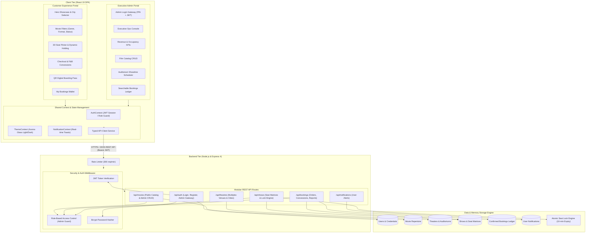

# IMovies — Cinema Management & Multiplex Ticketing Engine

[](https://react.dev/)
[](https://www.typescriptlang.org/)
[](https://nodejs.org/)
[](https://expressjs.com/)
[](https://www.mongodb.com/)
[](https://tailwindcss.com/)
[](https://vitejs.dev/)
[](https://jwt.io/)
[](LICENSE)

A modern, full-stack cinema ticketing and multiplex theatre management platform. Built on the MERN stack architecture with React 19, Express, and TypeScript, featuring real-time interactive seat locking, F&B concession upselling, QR-verifiable digital boarding passes, and a dedicated role-based Executive Administration Console.

---

## Table of Contents

- [Key Features](#key-features)
- [System Architecture](#system-architecture)
- [Tech Stack](#tech-stack)
- [Getting Started](#getting-started)
  - [Prerequisites](#prerequisites)
  - [Installation](#installation)
  - [Environment Variables](#environment-variables)
  - [Running the App](#running-the-app)
- [Demo Credentials](#demo-credentials)
- [API Reference](#api-reference)
- [Project Structure](#project-structure)
- [Scripts](#scripts)
- [License](#license)

---

## Key Features

### 🎬 Cinema & Showtimes Catalog
- **Now Showing & Upcoming Releases**: Categorized movie grid with high-resolution artwork, director, cast, runtimes, censor certificates, and audience ratings.
- **Multi-Dimensional Filters**: Filter premiere titles by genre (Action, Sci-Fi, Drama, Thriller, Animation), projection format, and city location.
- **Showtime Selector**: Instant lookup across regional multiplexes (IMAX Laser 4K, Dolby Cinema 64-Channel, 3D RealD).

### 💺 Interactive Seat Selection & Real-Time Locking
- **Curved 3D Screen Perspective**: Curved visual screen anchor mirroring authentic theatre acoustics and sightlines.
- **Tier-Based Seating Layout**: Clear tier differentiation across **Silver**, **Gold**, and **VIP Luxury Recliners**.
- **Real-Time Seat Hold System**: Atomic seat locking with countdown timers to prevent double-booking during checkout.

### 🍿 Concessions & Snack Upselling
- Integrated food & beverage selection (Gourmet Truffle Popcorn, Artisanal Sodas, Nacho Grande Platter, Cinema Combo Packs).
- Live subtotal calculations including taxes and convenience fees.

### 🎟️ Digital Boarding Pass & QR Pass
- High-fidelity boarding pass display featuring custom booking references, auditorium details, and seat badges.
- Built-in QR verification code and print-friendly ticket download.

### 🛡️ Protected Executive Administration Portal
- **Dedicated Security Gateway**: Guarded entry barrier requiring valid executive credentials and Master Security Clearance PIN.
- **Analytics & KPIs**: Real-time tracking of box-office revenue, seat occupancy percentages, genre revenue distributions, and venue utilization.
- **Movie Catalog Management**: Add, update, or decommission theatrical releases with format flags and metadata.
- **Showtime Scheduling Engine**: Schedule auditoriums, set start/end times, and configure tiered seat pricing.
- **Live Bookings Ledger**: Searchable customer transaction history with instant reference lookup.
- **One-Click Console Lock**: Instantly lock and secure administrative sessions.

### 🌗 Adaptive Glassmorphism Theme
- Custom design system with light and dark theme modes, ambient mesh aurora glows, and fluid micro-animations.

---

## System Architecture


<details>
<summary><b>Click to view interactive Mermaid Architecture Diagram</b></summary>


</details>

---

## Workflow & Process Flowchart


### End-to-End Workflow Stages

1. **Customer Ticketing Flow**:
   - **Discover**: Browse the premiere film catalog with genre, certificate, and projection filters (IMAX 4K Laser, Dolby Cinema 3D).
   - **Auditorium & Showtime**: Select city multiplex, screening date, and preferred auditorium hall.
   - **Interactive 3D Seating**: Choose specific tier-rated seats (Silver, Gold, VIP Luxury Recliners).
   - **Atomic 10-Minute Lock**: Backend locks chosen seats in real time to eliminate booking collisions.
   - **Concessions & Upselling**: Select artisanal cinema snacks and beverage combos.
   - **Instant Pass**: Verified 256-bit payment issues a digital boarding pass with unique reference & QR validation.

2. **Executive Admin Flow**:
   - **Clearance Verification**: Enter Executive Email, Password, and Master Security PIN (`7788`).
   - **Executive Console Access**: View live multiplex KPIs, revenue velocity, and seat occupancy graphs.
   - **Auditorium Operations**: Schedule new showtimes, set tier pricing, and update theatrical release statuses.
   - **Session Security**: Lock console back to standard customer view with one click.

---

## Tech Stack

- **Frontend**: React 19, TypeScript, Vite 8, Tailwind CSS 4 (Glassmorphism), Lucide Icons, Motion, Canvas-Confetti
- **Backend**: Node.js, Express 4, TypeScript, CORS, `tsx`
- **Database & ODM**: MongoDB & Mongoose (8 Collections with Compound Indexing, Auto-Seeding & In-Memory Fallback)
- **Authentication & Security**: JSON Web Tokens (`jsonwebtoken`), `bcryptjs` password encryption, Tier-1 Clearance PIN
- **API Architecture**: Express Rate Limiting (300 req/min), Centralized Error Handling, Query Pagination (`page`, `limit`)

---

## Database Design & Collections (MongoDB / Mongoose)

The platform is designed around 8 normalized Mongoose schemas with compound performance indexes:

1. **Users (`User.model.ts`)**: Profile data, credentials, roles (`user` vs `admin`), phone, and timestamps. *Indexes: `email: 1`, `role: 1`*.
2. **Movies (`Movie.model.ts`)**: Film details, genres, certificates, language, formats (IMAX, Dolby, 3D), posters, director, and cast. *Indexes: text search `{ title, description, director }`, `{ genre, isNowShowing }`*.
3. **Theatres (`Theatre.model.ts`)**: Multiplex venues, regional cities, locations, addresses, and screen auditoriums. *Index: `{ city: 1, name: 1 }`*.
4. **Shows (`Show.model.ts`)**: Links movie to theatre screen with dates, start/end times, tier pricing, and embedded seats. *Compound Indexes: `{ movieId: 1, showDate: 1 }`, `{ theatreId: 1, showDate: 1 }`, `{ showDate: 1, startTime: 1 }`*.
5. **Seats (`Seat.model.ts`)**: Embedded auditorium matrix partitioned into Silver, Gold, and VIP Recliners with real-time status (`available`, `locked`, `booked`) and lock leases.
6. **Bookings (`Booking.model.ts`)**: Order transactions linking customer to movie show with seat allocation, F&B snacks, tax, convenience fee, and QR code payload. *Indexes: `{ userId: 1, bookedAt: -1 }`, `{ showId: 1, bookingStatus: 1 }`, `bookingReference: 1`*.
7. **Payments (`Payment.model.ts`)**: Transaction logs with payment gateway IDs, status (`completed`, `refunded`), and amounts. *Index: `{ userId: 1, createdAt: -1 }`*.
8. **Notifications (`Notification.model.ts`)**: Transactional alerts for booking confirmations, ticket cancellations, and system updates. *Index: `{ userId: 1, createdAt: -1 }`*.

---

## Getting Started

### Prerequisites

- **Node.js**: v18.0.0 or higher
- **MongoDB**: Local MongoDB instance (`mongodb://localhost:27017`) or MongoDB Atlas URI (optional; app includes automated in-memory fallback)
- **npm** (v9+) or **bun** (v1.0+)

### Installation

1. Clone or download the repository:
   ```bash
   git clone https://github.com/your-username/imovies.git
   cd imovies
   ```

2. Install dependencies:
   ```bash
   npm install
   ```

### Environment Variables

Configure your environment settings in `.env` (a template is provided in `.env.example`):

```env
PORT=3000
NODE_ENV=development
APP_URL=http://localhost:3000
MONGODB_URI=mongodb://localhost:27017/imovies
JWT_SECRET=imovies_cinema_jwt_secret_token_secure_2026
```

### Running the App

Start the development server:
```bash
npm run dev
```

Open your browser and navigate to:
```
http://localhost:3000
```

---

## Demo Credentials

For testing and evaluation, the application includes pre-configured demo accounts:

| Role | Email | Password | Security PIN | Access Privileges |
| :--- | :--- | :--- | :--- | :--- |
| **Executive Administrator** | `admin@imovies.cinema` | `Admin@123` | `7788` | Full Admin Console, Analytics, Scheduling, Movie Management |
| **Standard Customer** | `alex@cinephile.com` | `User@123` | — | Movie Browsing, Seat Booking, Digital Ticket Wallet |

> **Tip**: You can use the **⚡ Autofill Credentials** button directly on the Admin Gateway login screen for instant evaluation.

---

## API Reference

### Authentication (`/api/auth`)
| Method | Endpoint | Description | Auth Required |
| :--- | :--- | :--- | :--- |
| `POST` | `/api/auth/register` | Register a new customer account | No |
| `POST` | `/api/auth/login` | Sign in to an existing account | No |
| `POST` | `/api/auth/admin-login` | Verify executive credentials & PIN | No |
| `GET` | `/api/auth/me` | Fetch authenticated user profile | Bearer Token |
| `GET` | `/api/auth/demo-accounts`| Retrieve demo login presets | No |

### Movies (`/api/movies`)
| Method | Endpoint | Description | Auth Required |
| :--- | :--- | :--- | :--- |
| `GET` | `/api/movies` | List movies with genre/format filters & pagination (`?page=1&limit=10`) | No |
| `GET` | `/api/movies/:id` | Get movie details and upcoming showtimes | No |
| `POST` | `/api/movies` | Create a new movie listing | Admin |
| `PUT` | `/api/movies/:id` | Update an existing movie | Admin |
| `DELETE`| `/api/movies/:id` | Delete movie and associated shows | Admin |

### Shows & Seats (`/api/shows`)
| Method | Endpoint | Description | Auth Required |
| :--- | :--- | :--- | :--- |
| `GET` | `/api/shows` | Retrieve shows by date, theatre, or film | No |
| `GET` | `/api/shows/:id` | Get auditorium seat matrix & pricing | No |
| `POST` | `/api/shows` | Schedule a new screening | Admin |
| `DELETE`| `/api/shows/:id` | Cancel a scheduled showtime | Admin |
| `POST` | `/api/shows/:id/lock-seats`| Temporarily lock seats for checkout | Bearer Token |

### Bookings & Concessions (`/api/bookings`)
| Method | Endpoint | Description | Auth Required |
| :--- | :--- | :--- | :--- |
| `POST` | `/api/bookings` | Finalize ticket purchase & confirm seats | Bearer Token |
| `POST` | `/api/bookings/:id/cancel`| Cancel booking, release seats & refund | Bearer Token |
| `GET` | `/api/bookings/my-bookings`| Get logged-in user's tickets | Bearer Token |
| `GET` | `/api/bookings/admin/all` | Retrieve all bookings with pagination (`?page=1&limit=20`) | Admin |
| `GET` | `/api/bookings/admin/stats` | Executive KPI and box office analytics | Admin |

---

## Project Structure

```
imovies/
├── server/
│   ├── auth.ts                     # JWT authentication & admin RBAC middleware
│   ├── db.ts                       # In-memory relational database & sample data
│   ├── mongoose.ts                 # MongoDB connection & auto-seeding engine
│   ├── models/                     # Mongoose Schemas & Models (MongoDB)
│   │   ├── Booking.model.ts        # Customer bookings & payment metadata
│   │   ├── Movie.model.ts          # Theatrical repertoire with text indexes
│   │   ├── Notification.model.ts   # Transactional alert messages
│   │   ├── Payment.model.ts        # Payment processing records
│   │   ├── Seat.model.ts           # Seat matrix subdocument schema
│   │   ├── Show.model.ts           # Shows with compound filtering indexes
│   │   ├── Theatre.model.ts        # Multiplex venues & screen halls
│   │   ├── User.model.ts           # User accounts with bcrypt password hashes
│   │   └── index.ts                # Models barrel export
│   └── routes/
│       ├── auth.routes.ts          # Auth, registration, and admin-login endpoints
│       ├── bookings.routes.ts      # Checkout, cancellation & revenue analytics
│       ├── movies.routes.ts        # Film catalog CRUD with pagination
│       ├── notifications.routes.ts # User transaction notifications
│       ├── shows.routes.ts         # Showtimes, seat grids & atomic locks
│       └── theatres.routes.ts      # Multiplex facilities & auditoriums
├── src/
│   ├── assets/                     # Curated film posters and visual assets
│   ├── components/
│   │   ├── AdminDashboard.tsx      # Executive Ops management console
│   │   ├── AdminLoginGateway.tsx   # Dedicated Admin security login portal
│   │   ├── AuthModal.tsx           # Customer sign-in & registration modal
│   │   ├── CheckoutModal.tsx       # Payment summary, concessions & order confirmation
│   │   ├── DigitalTicketPass.tsx   # QR boarding pass card
│   │   ├── HeroBanner.tsx          # Featured premiere showcase & city selector
│   │   ├── MovieCard.tsx           # Film display card with format pills
│   │   ├── MovieFilters.tsx        # Segmented controls for genre, format & status
│   │   ├── MyBookingsView.tsx      # Customer ticket wallet & history
│   │   ├── Navbar.tsx              # Top navigation bar with theme & session controls
│   │   ├── SeatSelectionView.tsx   # Interactive auditorium seat layout
│   │   ├── ShowtimeSelectorModal.tsx # Theatre & timing picker
│   │   └── TheatresView.tsx        # City multiplex directory & screen listings
│   ├── context/
│   │   ├── AuthContext.tsx         # User authentication & role management
│   │   ├── NotificationContext.tsx # Toast messages & alerts
│   │   └── ThemeContext.tsx        # Light/Dark mode state
│   ├── services/
│   │   └── api.ts                  # Typed client HTTP service
│   ├── types/
│   │   └── index.ts                # TypeScript interfaces and domain models
│   ├── App.tsx                     # Main application view coordinator
│   ├── index.css                   # Tailwind v4 configuration & theme tokens
│   └── main.tsx                    # React application bootstrap
├── server.ts                       # Express server & Vite development middleware
├── vite.config.ts                  # Vite build & bundle configuration
├── tsconfig.json                   # TypeScript compiler options
└── package.json                    # Project dependencies and npm scripts
```

---

## Scripts

| Command | Description |
| :--- | :--- |
| `npm run dev` | Starts the Express server with Vite middleware in development mode |
| `npm run build` | Builds the client bundle into the `dist/` directory for production |
| `npm run start` | Runs the production Express server serving compiled static assets |
| `npm run lint` | Runs `tsc --noEmit` to validate all TypeScript types |
| `npm run clean` | Cleans previous build artifacts |

---
